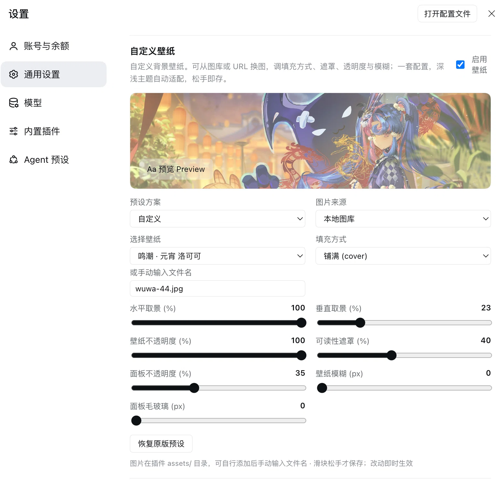

# dsh-custom-wallpaper

[](https://github.com/caseclose/dsh-custom-wallpaper/actions/workflows/ci.yml)

[简体中文](README.md) | English

A configurable custom wallpaper plugin for the **DeepSeek Harness** Web UI.

Set any image as the background behind the whole app, with a live-preview
settings row, a grouped wallpaper picker, presets and per-theme veil colours.



*Actual settings row in DeepSeek Harness, shown with a sample wallpaper.*

> ⚠️ **No wallpaper files are bundled.** The only image shipped in `assets/` is
> `assets/default.svg`, an original placeholder. You supply the wallpapers
> yourself — see [Adding wallpapers](#adding-wallpapers). Do not commit
> copyrighted game art or downloaded stock photos to a public fork.
> The screenshot above includes a sample wallpaper used only to illustrate the
> UI; that artwork belongs to its respective rights holder and no such image
> file is distributed in this repository.

## Features

- **One shared configuration**: a single image and one set of values for both
  light and dark themes. CSS switches the veil / surface colours automatically
  (white veil in light mode, black veil in dark mode); no duplicate settings.
- **Image sources**: a local library (`assets/`, grouped dropdown) or any image URL.
- **Display**: `cover` / `contain` / fixed pixel width, plus X/Y focus.
- **Appearance**: wallpaper opacity, readability scrim, panel translucency,
  wallpaper blur and frosted-glass blur.
- **Presets**: Original / Soft / Clear / Eye care, or Custom.
- Settings persist in DSH's official settings document, survive restarts and
  apply immediately (`.volatile()` fields).

## Install

This plugin is distributed **from this Git repository only** — it is not
published to npm. Install straight from GitHub (pin a commit; DSH runs a
git-hosted bundle's build step at install time, so pinning keeps that code
stable):

```sh
dsh plugin --profile web add github:caseclose/dsh-custom-wallpaper#8018ee4
```

Or clone and install from a local directory:

```sh
git clone https://github.com/caseclose/dsh-custom-wallpaper.git
dsh plugin --profile web add /path/to/dsh-custom-wallpaper
```

Replace `8018ee4` with a newer `git rev-parse HEAD` value if you want a later
revision. Then reload the Web page. Configure it in
**Settings → General → Custom wallpaper** (or **Settings → Plugins** for the
generated full form).

## Adding wallpapers

1. Put your images in `assets/` (JPG / PNG / WebP / AVIF / SVG).
2. Run `python3 tools/build-client.py` (or `npm run build`).
3. Reload the page — new files appear in the picker.

Entries are derived by scanning `assets/` at build time. For nicer labels and
custom groups, copy `wallpaper-catalog.example.json` to
`wallpaper-catalog.json` and edit it. Both files are metadata only; neither
contains images.

## Configuration

| Field | Meaning |
|---|---|
| `enabled` | Remove the wallpaper and all overrides when off |
| `preset` | `original` / `soft` / `clear` / `eyeCare` / `custom` |
| `imageSource` | `library` / `url` |
| `imageUrl`, `assetName` | URL or library file name |
| `fit` | `fixed` / `cover` / `contain` |
| `fixedWidth`, `positionX`, `positionY` | Size and focus |
| `opacity`, `scrim`, `panelAlpha` | Wallpaper / veil / panel strength |
| `wallpaperBlur`, `glassBlur` | Optional blur effects |

## Development

```sh
python3 tools/build-client.py   # regenerate client.js
node tools/smoke-test.cjs       # headless checks
npm pack --dry-run              # verify the package contents
```

`tools/client-template.js` is the source of the browser module;
`tools/build-client.py` injects the dictionaries and the asset list into it.
The Host half is `index.js` (Config schema), activated by `cordis.patch.yml`.

## Copyright

- Plugin code: MIT, see [LICENSE](LICENSE).
- `icon.svg` and `assets/default.svg`: original artwork for this project.
- `docs/settings-preview.webp`: a screenshot of the plugin's settings row. It
  contains a sample wallpaper (game artwork) visible only as part of that UI
  capture; rights remain with the owner and no such image file is shipped here.
- Wallpapers you add: whatever license **you** hold. Game artwork (e.g.
  Wuthering Waves © KURO GAMES, Honkai: Star Rail © miHoYo / HoYoverse) and
  stock photos are **not** covered by this repository's license and are not
  distributed here.

Third-party rights remain with their respective owners. Use such images only
in ways their own terms allow.
