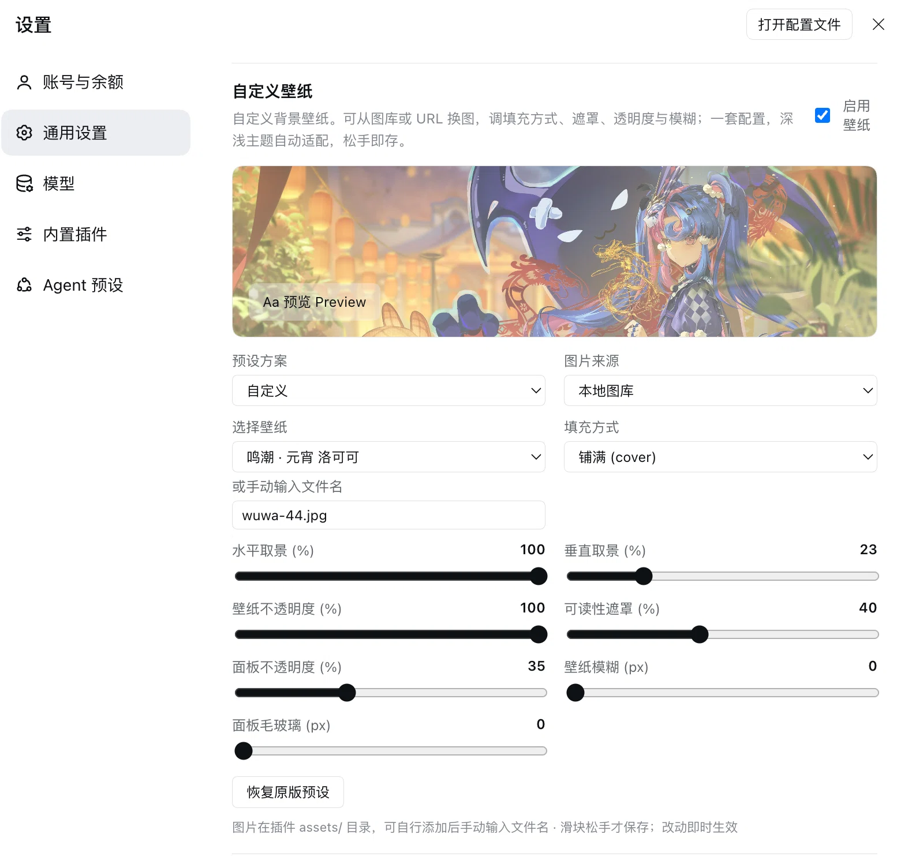

# dsh-custom-wallpaper

[](https://github.com/caseclose/dsh-custom-wallpaper/actions/workflows/ci.yml)

简体中文 | [English](README.en.md)

给 **DeepSeek Harness** 网页界面使用的自定义壁纸插件。

把任意图片设为整个应用背后的背景，带实时预览的设置行、分组壁纸选择器、预设方案，以及随主题自动切换的纱帘颜色。



*DeepSeek Harness 中真实的设置行界面，展示时使用了示例壁纸。*

> ⚠️ **仓库不附带任何壁纸文件。** `assets/` 里唯一的图片是原创占位图
> `assets/default.svg`。壁纸需要你自己放 —— 见[添加壁纸](#添加壁纸)。请勿把
> 受版权保护的游戏美术或下载的图库照片提交到公开仓库。
> 上面的截图包含一张仅用于说明界面的示例壁纸，其权利归原作者所有，本仓库不
> 分发该图片文件。

## 功能

- **一套配置**：深浅主题共用同一张图和同一组参数。CSS 自动切换纱帘与面板底色
  （浅色白纱、深色黑纱），没有重复设置。
- **图片来源**：本地图库（`assets/`，分组下拉）或任意图片 URL。
- **显示方式**：`cover` / `contain` / 固定像素宽度，外加 X/Y 取景。
- **观感**：壁纸不透明度、可读性遮罩、面板半透明度、壁纸模糊、毛玻璃模糊。
- **预设**：原版 / 淡雅 / 清晰 / 护眼，或自定义。
- 配置保存在 DSH 官方设置文档中，跨重启保留，改动即时生效（`.volatile()` 字段）。

## 安装

本插件**仅通过本 Git 仓库分发**，未发布到 npm。直接从 GitHub 安装（建议锁定
commit：DSH 会在安装时执行 git 包的构建步骤，锁定可保证运行的代码不变）：

```sh
dsh plugin --profile web add github:caseclose/dsh-custom-wallpaper#8018ee4
```

或克隆后从本地目录安装：

```sh
git clone https://github.com/caseclose/dsh-custom-wallpaper.git
dsh plugin --profile web add /path/to/dsh-custom-wallpaper
```

想要更新的版本，把 `8018ee4` 换成 `git rev-parse HEAD` 的结果。之后刷新网页即可。
在 **设置 → 通用 → 自定义壁纸** 中配置（或到 **设置 → 插件** 使用自动生成的
完整表单）。

## 添加壁纸

1. 把图片放进 `assets/`（JPG / PNG / WebP / AVIF / SVG）。
2. 运行 `python3 tools/build-client.py`（或 `npm run build`）。
3. 刷新页面 —— 新文件会出现在选择器里。

选项在构建时扫描 `assets/` 自动生成。想要更好看的标签和自定义分组，把
`wallpaper-catalog.example.json` 复制为 `wallpaper-catalog.json` 再编辑。两者都
只是元数据，不含图片。

## 配置项

| 字段 | 含义 |
|---|---|
| `enabled` | 关闭后移除壁纸及所有覆盖样式 |
| `preset` | `original` / `soft` / `clear` / `eyeCare` / `custom` |
| `imageSource` | `library` / `url` |
| `imageUrl`, `assetName` | 图片地址或图库文件名 |
| `fit` | `fixed` / `cover` / `contain` |
| `fixedWidth`, `positionX`, `positionY` | 尺寸与取景 |
| `opacity`, `scrim`, `panelAlpha` | 壁纸 / 纱帘 / 面板强度 |
| `wallpaperBlur`, `glassBlur` | 可选模糊效果 |

## 开发

```sh
python3 tools/build-client.py   # 重新生成 client.js
node tools/smoke-test.cjs       # 无头检查
npm pack --dry-run              # 检查包内容
```

`tools/client-template.js` 是浏览器模块的源文件，`tools/build-client.py` 把字典
和图库清单注入其中。Host 半部是 `index.js`（Config schema），由
`cordis.patch.yml` 激活。

## 版权

- 插件代码：MIT，见 [LICENSE](LICENSE)。
- `icon.svg` 与 `assets/default.svg`：本项目原创美术。
- `docs/settings-preview.webp`：插件设置行截图，其中作为界面的一部分出现了一张
  示例壁纸（游戏美术）；权利归原作者，本仓库不分发该图片文件。
- 你自行添加的壁纸：遵循**你自己**持有的授权。游戏美术（例如《鸣潮》
  © KURO GAMES、《崩坏：星穹铁道》© miHoYo / HoYoverse）与图库照片不受本仓库
  许可证覆盖，也不在此分发。

第三方权利归各自所有者所有，请仅在其条款允许的范围内使用。
